# Informe Laboratorio 2: La raíz que se esconde
**Autor:** Benjamín Barros

## 1. Ambiente controlado

Para todas las pruebas usé una tolerancia de `1e-6` y un límite de 100 iteraciones. Los métodos paran si el valor absoluto de la función o el tamaño del paso es menor que la tolerancia.

| Función | Intervalo [a, b] | $x_0$ Punto fijo y Newton-Raphson | $x_1$ Secante | Raíz aproximada |
|---|---|---|---|---|
| $x^3 - x - 2$ | [1, 2] | 1.5 | 1.6 | 1.521380 |
| $(x - 2)^2$ | Sin cambio de signo | 1.2 | 1.5 | 2.000000 |
| $\ln(x) + x - 4$ | [2, 3] | 2.5 | 2.6 | 2.926271 |
| $e^{-x} - x$ | [0, 1] | 0.5 | 0.6 | 0.567143 |
| $\cos(x) - x$ | [0, 1] | 0.5 | 0.6 | 0.739085 |
| $\sqrt{x} - \cos(x)$ | [0.1, 1] | 0.5 | 0.6 | 0.641714 |

**Comprobación con el teorema de Bolzano:**
Evalué la función en los extremos del intervalo para ver si cambia de signo:

- $f_1(1) = -2$, $f_1(2) = 4$.
- $f_3(2) \approx -1.31$, $f_3(3) \approx 0.10$.
- $f_4(0) = 1$, $f_4(1) \approx -0.63$.
- $f_5(0) = 1$, $f_5(1) \approx -0.46$.
- $f_6(0.1) \approx -0.68$, $f_6(1) \approx 0.46$.

En estos cinco casos hay cambio de signo. Para $(x - 2)^2$, la función toca el eje en $x=2$, pero no lo cruza. Por eso no se puede aplicar Bolzano con un intervalo de cambio de signo

Los gráficos de las funciones están en `src/assets/`:

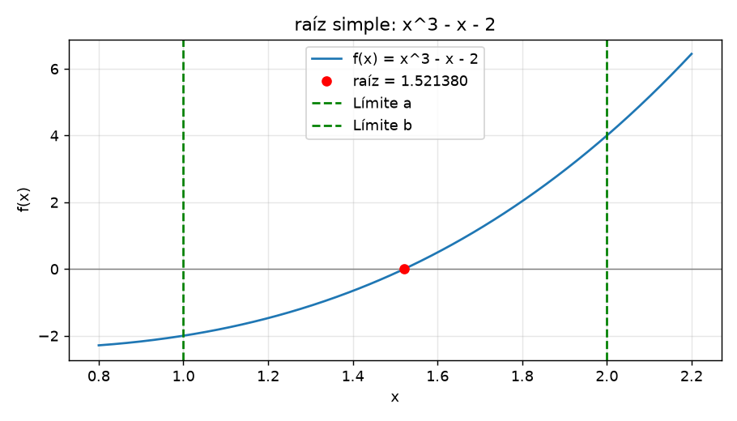
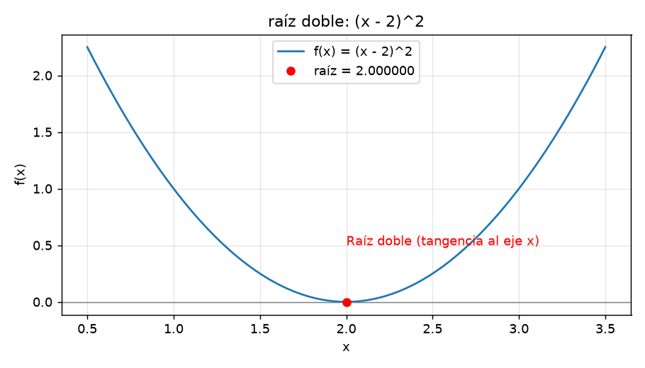
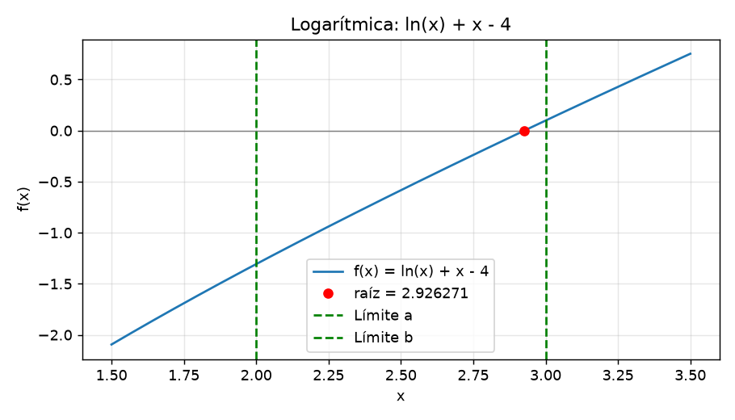
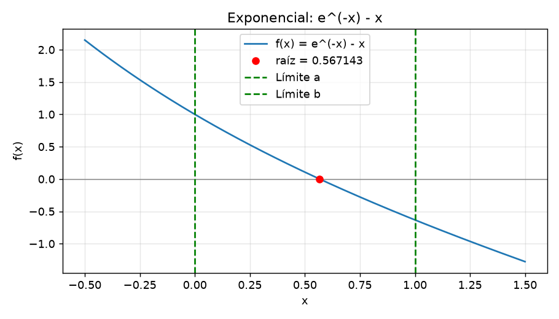
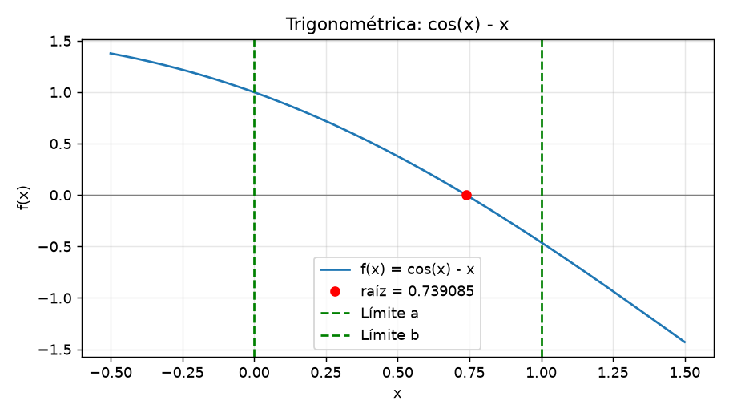
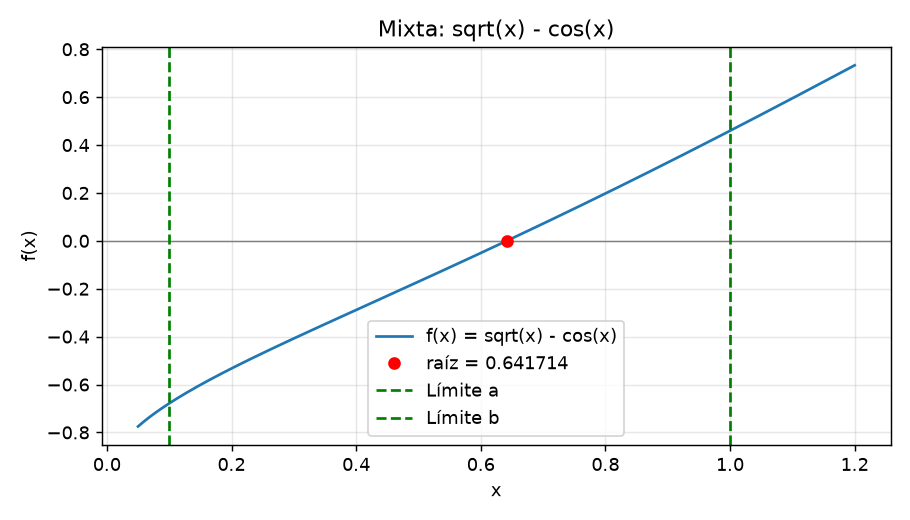

## Resultados: iteraciones hasta converger (tol = 1e-6)

La tabla muestra las iteraciones que necesitó cada método. En la raíz doble, Bisección y Falsa posición no aplican porque no hay cambio de signo

| Función | Bisección | Falsa posición | Punto fijo | Secante | Newton | Newton mejorado |
|----|----|----|----|----|----|----|
| $x^3 - x - 2$ | 20 | 12 | 7 | 3 | 2 | 2 |
| $(x - 2)^2$ | No aplica | No aplica | 20 | 13 | 10 | 1 |
| $\ln(x) + x - 4$ | 19 | 4 | 14 | 3 | 3 | 3 |
| $e^{-x} - x$ | 20 | 7 | 22 | 3 | 2 | 2 |
| $\cos(x) - x$ | 20 | 5 | 34 | 3 | 3 | 3 |
| $\sqrt{x} - \cos(x)$ | 20 | 4 | 14 | 3 | 2 | 2 |

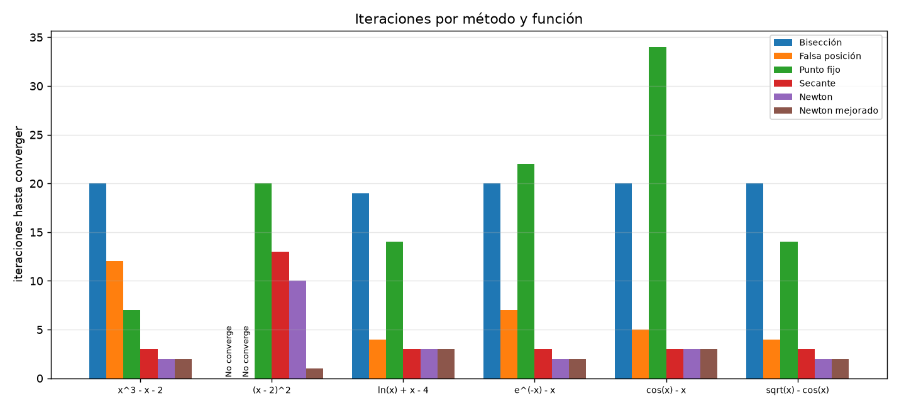

Gráficos de convergencia:

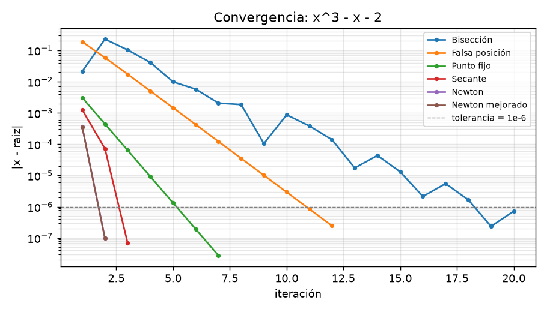
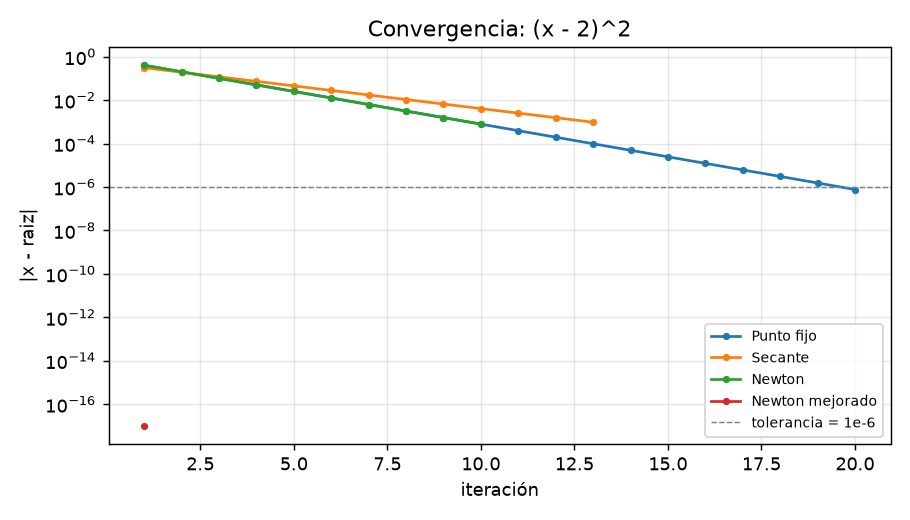
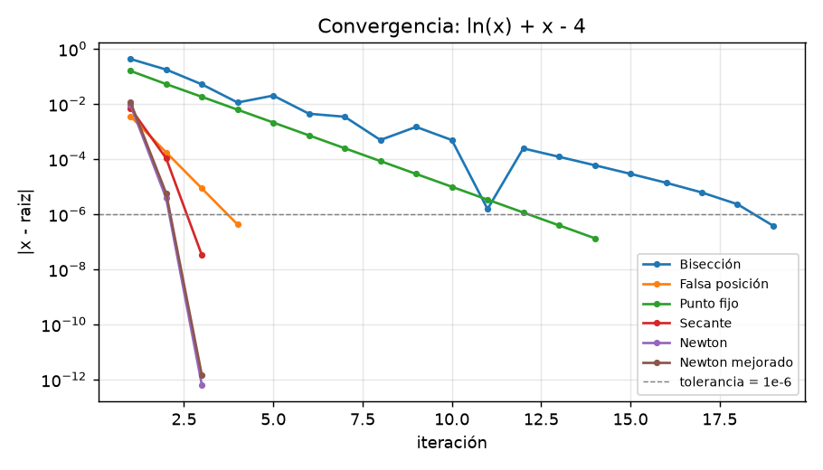
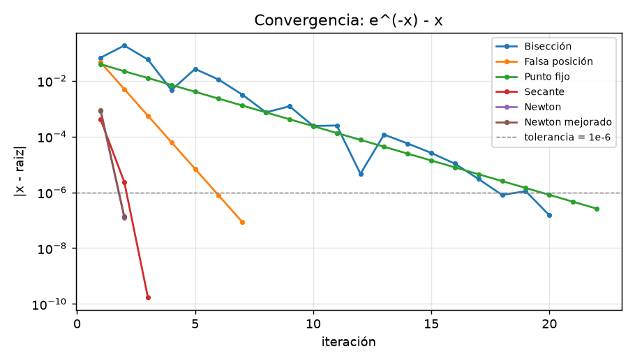
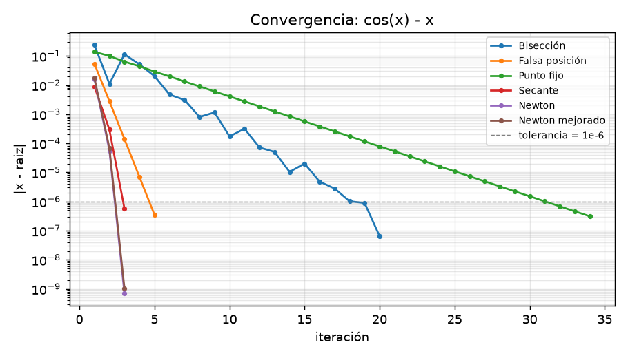
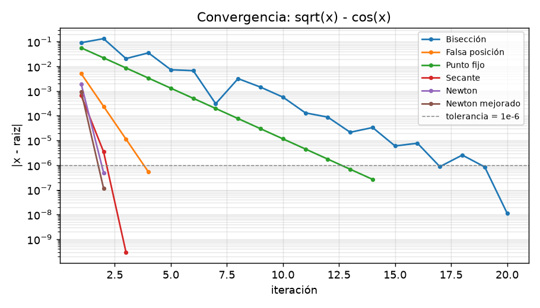

## 2. Preguntas de convergencia

**1. ¿Qué método convergió en menos iteraciones y por qué?**

En las funciones de raíz simple, Newton y Newton mejorado necesitaron 2 o 3 iteraciones. Usan la pendiente de la función para calcular el siguiente valor, por eso llegaron rápido con los puntos iniciales elegidos.

**2. ¿Qué orden de convergencia tiene cada método y cómo se ve en el gráfico?**

- Bisección y falsa posición tienen convergencia lineal en estos casos.
- El orden del punto fijo depende de la función $g$. En estas pruebas el error bajó de forma más gradual.
- La secante tiene convergencia superlineal, de orden aproximado 1.618.
- Newton y Newton mejorado tienen convergencia cuadrática cerca de una raíz simple.

En el caso de $\ln(x)+x-4$, el error de Newton pasó de aproximadamente `9e-3` a `4e-6` y después a `6e-13` en tres iteraciones.

**3. ¿Qué métodos requieren cambio de signo?**

Bisección y falsa posición necesitan un intervalo con cambio de signo. Punto fijo, secante y Newton parten de estimaciones iniciales. Con una estimación poco adecuada pueden no converger.

**4. Análisis de la raíz doble en $(x - 2)^2$**

Bisección y falsa posición no aplican aquí porque los extremos no tienen cambio de signo. Newton clásico necesitó 10 iteraciones y la secante 13. En raíces simples habían necesitado 2 o 3. Newton mejorado encontró la raíz en una iteración.

Hay otra cosa que se nota en los datos: Newton y la secante paran cuando $|f(x)| < 1e-6$, pero para esta raíz doble eso no significa que $x$ esté a menos de `1e-6` de la raíz. Newton terminó con un error de aproximadamente `8e-4` y la secante con uno de `1e-3`.

**5. Influencia del intervalo y la estimación inicial**

En $x^3-x-2$, al ampliar el intervalo, falsa posición pasó de 12 a 20 iteraciones. Newton pasó de 2 a 5 cuando usé $x_0=1$. En la función mixta, con $x_0=0.1$, Newton mejorado llegó al límite de 100 iteraciones: NumPy mostró advertencias por la raíz cuadrada de un valor negativo y siguió produciendo `nan`.

**6. ¿Qué método recomiendan según el tipo de función?**

- Si se tiene la derivada y un buen punto inicial, usaría Newton-Raphson por la rapidez.
- Si no se quiere calcular la derivada, se puede usar la secante.
- Si se tiene un intervalo con cambio de signo, falsa posición fue más rápida que bisección en estos ejemplos.
- Para la raíz doble de estas pruebas, Newton mejorado fue el más rápido.

## 3. Conclusión

- **Método según el caso:** en las cinco funciones de raíz simple, Newton y Newton mejorado necesitaron 2 o 3 iteraciones, y la secante necesitó 3. Falsa posición necesitó entre 4 y 12, mientras que bisección necesitó entre 19 y 20. En estas pruebas usaría Newton para rapidez y falsa posición si tengo un intervalo con cambio de signo.
- **Raíz doble:** $(x-2)^2$ tiene raíz en $x=2$, aunque no cambia de signo. Por eso Bisección y Falsa posición no aplican. Newton clásico necesitó 10 iteraciones, la secante 13 y Newton mejorado una.
- **Intervalo y punto inicial:** al cambiar el intervalo de $x^3-x-2$, falsa posición pasó de 12 a 20 iteraciones. Con $x_0=1$, Newton pasó de 2 a 5. En la función mixta, Newton mejorado no convergió con $x_0=0.1$ dentro del máximo de 100 iteraciones.
